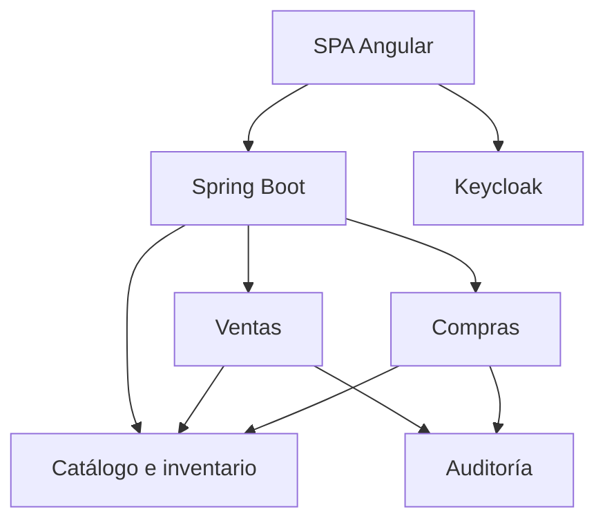

# Arquitectura

Un único backend Spring Boot, un solo pom.xml y una SPA. No hay microservicios, Maven reactor ni comunicación Feign. El frontend conserva los tokens visuales oscuros del ZIP de referencia; se reemplazaron las pantallas ligadas a otros negocios.

| Módulo backend | Responsabilidad | API pública para otros módulos |
|---|---|---|
| catalogo | Categorías, productos, precio y stock | service y dto mediante @NamedInterface |
| ventas | Clientes y ventas con detalle | REST; no exporta repositorios |
| compras | Proveedores y compras recibidas con detalle | REST; no exporta repositorios |
| auditoria | Registro de operaciones críticas | service mediante @NamedInterface |
| seguridad | Administración autorizada de cuentas y roles Keycloak | REST solo ADMIN; cliente confidencial backend |
| common | Configuración, seguridad, errores, correlación y DTO de página | Compartido, módulo abierto |

Dentro de cada módulo: controller, dto, service, repository, entity y mapper. Los controladores delegan reglas a servicios; la API devuelve DTO. Ventas y compras solo utilizan ProductoService y sus DTO, nunca ProductoRepository ni entidades de catálogo.

Spring Modulith verifica las dependencias permitidas con ModularityTests. Catálogo y auditoría no dependen de ventas ni compras, evitando ciclos. Inventario no se crea como paquete vacío: las existencias por producto forman parte del catálogo, suficiente para el alcance de una sucursal.

## Relaciones

| Relación | Implementación |
|---|---|
| Categoría → Producto | 1:N con ManyToOne y FK |
| Cliente → Venta | 1:N; cliente opcional |
| Proveedor → Compra | 1:N; proveedor obligatorio |
| Venta ↔ Producto | N:M resuelto con DETALLES_VENTA: cantidad, precio y subtotal |
| Compra ↔ Producto | N:M resuelto con DETALLES_COMPRA: cantidad, costo y subtotal |

El detalle usa un productoId y una FK SQL entre esquemas, en lugar de importar la entidad JPA interna de otro módulo. La cabecera usa OneToMany y el detalle ManyToOne hacia su cabecera. No se utiliza ManyToMany directo porque la asociación tiene atributos propios.

Esquemas Oracle: MM_CATALOGO, MM_VENTAS, MM_COMPRAS y MM_AUDITORIA. CANTOMODA_APP tiene acceso DML a las tablas y CREATE SESSION; las tablas se crean con SQL, nunca con ddl-auto:update. Los dueños de esquema son cuentas sin autenticación.

## Reglas y transacciones

- Al menos una línea; cantidades enteras positivas, máximo 100 líneas y productos sin repetir.
- Venta: precio leído del catálogo en el backend. Compra: costo positivo informado por el usuario y validado por el servidor.
- Fecha, actor, estado y total de la operación los decide el servidor.
- Crear actualiza stock y guarda cabecera, detalles y auditoría dentro de la misma transacción. Un fallo revierte todo. No existe aún una tabla independiente de movimientos de inventario.
- Estado inicial REGISTRADA; única transición ANULADA. No hay edición libre ni borrado físico de transacciones confirmadas.
- Anulación de venta devuelve stock una sola vez; anulación de compra resta stock y se rechaza si no alcanza.
- Filas de producto y cabecera se bloquean al modificarse; IDs de productos se procesan ordenados para mantener un orden de acceso estable.
- La auditoría se guarda en la misma transacción después de persistir la operación; un rollback también revierte su registro.
- El precio y nombre vendidos se guardan como copia histórica en el detalle.

Angular: core contiene layout, modelos, auth, guards, interceptor y HTTP; shared contiene listas/formularios reutilizados; features contiene las pantallas específicas de catálogo, login y auditoría. Las rutas de ventas/compras configuran componentes compartidos sin duplicar código. Todas se cargan mediante loadComponent.
